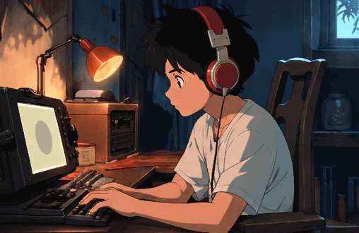

  

  

  
  
  

 

## 🌸 Sobre mí

  

  <b>Hola, soy Zaid</b> 👋 
  🎓 Estudiante de <b>DAM</b> · ☕ Java · Kotlin · Python 
  🏯 Fundador de <b>Zaid Smart</b> · 🍥 Anime y ⚽ fútbol 
  <i>Convierto ideas en apps reales.</i>

## ⚔️ Arsenal

  

## 🏮 Proyectos

| | Proyecto | Qué es | Estado |
|:-:|---|---|:-:|
| 🎙️ | [**zaid**](https://github.com/Diaz003/zaid) | Asistente de voz con IA | 🔥 En marcha |
| 🍥 | **zaidAnime** | App de anime y merchandising | 🎬 En desarrollo |
| ⚔️ | **FORJA** | App de disciplina personal | 🛠️ Diseño |
| 🚌 | **App de transporte** | Buses, tren y taxis en tiempo real | 💭 Idea |
| ⚽ | **Juego de fútbol web** | Fútbol con supertécnicas | 🎮 En desarrollo |

## ⚡ Nivel de poder

  
  

  

<i>「 一歩ずつ、コードで夢を 」— paso a paso, sueños hechos código</i>

  

